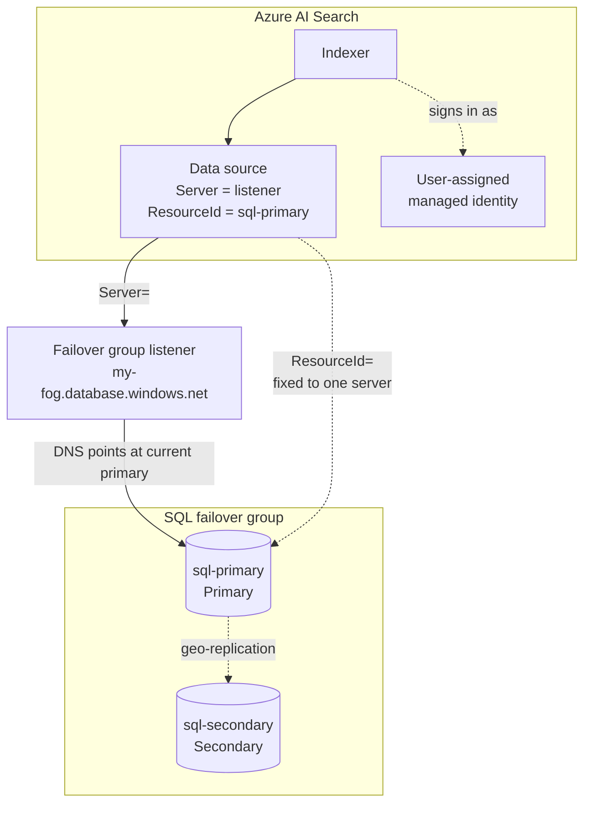
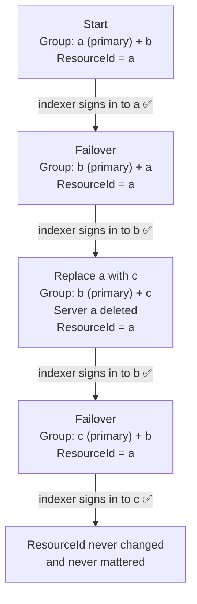
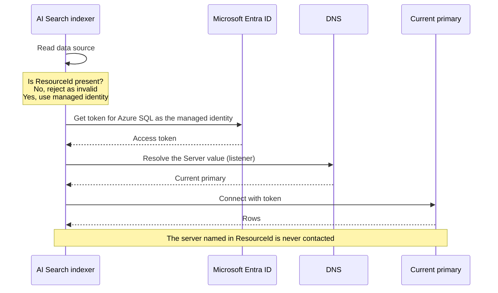

If you index an Azure SQL database with Azure AI Search, you will probably want the indexer to use a managed identity rather than a SQL username and password. You will probably also want the database in a failover group, so it can survive a regional outage. Put those two things together and you hit an odd-looking connection string with an open question inside it.

This post explains that question, how I tested it, and what I found.

## The Connection String

An Azure SQL data source in AI Search that uses a managed identity has a connection string like this:

```text
Server=tcp:my-fog.database.windows.net,1433;
Database=my-db;
ResourceId=/subscriptions/<sub-id>/resourceGroups/<rg>/providers/Microsoft.Sql/servers/sql-primary;
Encrypt=True;TrustServerCertificate=False;Connection Timeout=30;
```

There are two parts that both seem to say where the database is:

- **`Server=`** is the failover group **listener**, `my-fog.database.windows.net`. This is a DNS name that always points at whichever server is currently primary. Normal applications use it so they follow a failover without a config change.
- **`ResourceId=`** is the Azure resource ID of **one specific SQL server**. The [Microsoft docs](https://learn.microsoft.com/azure/search/search-howto-managed-identities-sql) say to include it for managed identity connections. It cannot point at the failover group, because a failover group is not a server.

So the listener moves, but the `ResourceId` is fixed to a single server.



That leaves two questions:

1. **Failover.** After a failover, `sql-primary` is now the secondary. Does the indexer still work while `ResourceId` names it?
2. **Replacement.** Say you replace `sql-primary` with a new server with a different name, and delete the old one. Normal clients are fine, because they use the listener. Does the Search data source still connect, when its `ResourceId` names a server that no longer exists?

I couldn't find an answer in the docs, and I'd seen a code comment warning that deleting the `ResourceId` server would break the indexer. Nobody had tested it. So I did.

## The Experiment

I ran this test on 10 November 2026. I built a throwaway environment with Terraform, using local state so `terraform destroy` would clean everything up afterwards:

- Three SQL servers, **a**, **b** and **c**, with Entra-only sign-in (no SQL passwords anywhere).
- One small database in a failover group, with **a** as primary and **b** as secondary. The failover policy was set to manual, so failovers only happened when I triggered them.
- Server **c** started outside the group. It plays the "replacement" server.
- An AI Search service on the **Basic** tier. The Free tier does not support managed identity for indexers.
- A user-assigned managed identity on the Search service. It had `Reader` on each SQL server, and a contained database user in `db_datareader`.
- **SQL auditing** on every server, sending events to a Log Analytics workspace. This was the key piece of evidence. It shows exactly which server the indexer signed in to each time.

Every test case followed the same steps:

1. Insert a new row on the current primary.
2. Update the data source connection string.
3. Run the indexer.
4. Check that the document count matches the row count.
5. Check the audit log to see which server the indexer signed in to.

The indexer had no change detection policy, so every run re-read the whole table. That made the row count a simple pass or fail check.

## The Results

| Case | Setup                                 | `ResourceId` names           | Result                                   | Indexer signed in to |
| ---- | ------------------------------------- | ---------------------------- | ---------------------------------------- | -------------------- |
| 1    | a is primary                          | a                            | ✅ Success                                | a                    |
| 2    | After failover to b                   | a (now secondary)            | ✅ Success, includes the row written on b | b                    |
| 3    | b is primary                          | b                            | ✅ Success                                | b                    |
| 4    | b is primary                          | c (exists, not in the group) | ✅ Success                                | b                    |
| 5    | b is primary                          | A server that does not exist | ✅ Success                                | b                    |
| 6a   | Group rebuilt as b + c, **a deleted** | a (deleted)                  | ✅ Success                                | b                    |
| 6b   | Then failover to c                    | a (deleted)                  | ✅ Success                                | c                    |
| 7    | Any                                   | Removed                      | ❌ Data source rejected                   | n/a                  |

Every case with a `ResourceId` worked, even when it named a server that had been deleted, or one that never existed. The audit logs showed the indexer always signed in to whichever server the listener pointed at.

Case 6 is the real-world replacement scenario, so here it is step by step:



### You Cannot Remove ResourceId

Case 7 was the one failure. Without `ResourceId`, Search refuses to save the data source:

```text
HTTP 400
An explicit identity should only be specified with a Managed Identity connection string.
```

With a user-assigned identity, the `ResourceId` is what marks the connection string as a managed identity connection string. Without it, Search treats the string as a classic one that should hold a username and password. Then it rejects the request, because an identity was also supplied.

### Ruling Out False Positives

When everything passes, it's worth asking whether the test can fail at all. There were two things to rule out:

- **Is Search really using my updates, or a cached connection?** As a control, I pointed `Server=` straight at server **c**, which had no database and no user for the identity. The indexer failed with `Login failed for user '<token-identified principal>'`. So data source updates take effect right away, and the passes are real.
- **Is the indexer really signing in as the managed identity?** The principal in the SQL audit log was the client ID of the user-assigned identity, every time.

## What Is Actually Going On

I can't see inside AI Search, so this is a description of how it *behaves*, not how it is built. The results fit this model:



- **`ResourceId` is a switch.** Its presence tells Search to use managed identity sign-in. Its value is not checked against a real server, at least not over a public network path.
- **`Server=` is the target.** The indexer connects wherever it points, which for a listener means the current primary.
- **The token is not tied to one server.** Entra ID issues the access token for Azure SQL as a whole, not for a single server. That's why one token works against a, b or c. Each server then checks that the identity has a user in its database. In a failover group, that user is copied to the secondary with the rest of the database.

## What This Means in Practice

- **A failover needs no change** to your AI Search data sources, as long as `Server=` is the listener.
- **Replacing or deleting the server named in `ResourceId` does not break the indexer.** You can tidy the value up afterwards, but nothing forces you to.
- **Keep `ResourceId` in the string.** Pointing it at a server that exists is good hygiene and avoids confusing the next person, but it is not what makes the connection work.
- **Check your other dependencies on the old server.** If your Search service reaches SQL through a **shared private link**, that link targets one specific server. It has nothing to do with `ResourceId`, but it will still break when that server is deleted. Make sure there is a link to every server the listener can point at.
- **Give the identity access on every server it might reach.** Keep `Reader` (or whatever role your setup needs) on each server in the group, not only the current primary.

## What I Did Not Test

- **Private networking.** The test used public access with "Allow Azure services". I'd expect `ResourceId` to behave the same over shared private links, since this is about sign-in rather than networking, but I haven't proven it.
- **Removing the `Reader` role** on the SQL servers.
- **Change detection policies** such as high water mark or integrated change tracking.

## Practical Notes If You Repeat This

- **Use auditing, not row counts alone, to prove which server answered.** Geo-replication copies rows to the secondary quickly, so the data alone can't tell you which server the indexer read from.
- **Write test rows to the primary by its server name**, not through the listener. Your local DNS cache can lag a failover, and you'll get `Failed to update database because the database is read-only`.
- **Make your scripts fail on HTTP errors.** My first run of case 7 looked like a pass. The data source update had been rejected, and the indexer quietly ran with the previous config. Adding `curl --fail-with-body` caught it.
- **A disabled indexer can't be run on demand.** Create it enabled with no schedule instead.
- **Check region capacity.** The first region I tried had no capacity for AI Search Basic (`ResourcesForSkuUnavailable`), so I had to use another one.

The short version: keep `ResourceId` in the connection string, point `Server=` at the listener, and stop worrying about which server `ResourceId` names.
